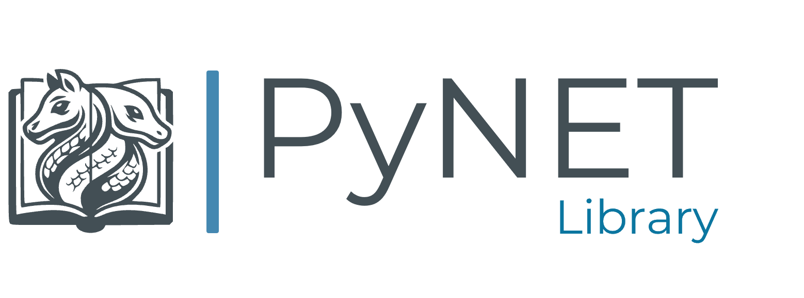

  

  
  
  
  

#

**PyNET Library is the knowledge that lets an AI write working automation for your BIM tools on
the first try.** It ships with the **[PyNET Platform](https://github.com/RAEN-DT/PyNet)** and is
what the AI reads before it writes a single line of code for Autodesk **Navisworks**, **Revit** and
**Civil 3D**, **Rhino**, **Tekla Structures** and **RIB Presto**.

> 🔒 **The library is not published as source.** It is proprietary content of RAEN Digital Tools
> and is installed with the PyNET Platform for licensed users. This repository only presents it.

### 📥 Request the 30 days **Trial** here:
Contact: **info@raendt.com** to request access.

---

## 🧠 Why an AI needs it

General-purpose AI models know Python, but not the details that make a script fail inside a BIM
host: which API call needs a transaction, which units a value comes in, which object must be
locked or re-read, which shortcut silently does nothing. PyNET Library captures those details,
verified against the live applications, so the AI gets them right instead of discovering them
at runtime on your model.

## 📚 What is inside

| Content | What it gives the AI |
| :--- | :--- |
| **Recipes** | 25 topic guides per host — when to use each technique, what to watch out for, and validated code. Selection and filters, parameters and families, clashes, Civil 3D corridors and sections, Tekla parts, Presto budgets, charts and more |
| **API patterns** | The rules each host enforces: transactions, document locks, units and coordinates, identity of elements across sessions |
| **API stubs** | 12,213 classes from the host APIs, indexed so the AI checks a signature instead of guessing it |
| **Host guides** | 34 documents on execution, user interface, exports, coordination and troubleshooting |
| **Workflows** | Complete, tested automations (5D takeoff to Presto, clash coordination, model audits, exports) available as buttons |
| **AI router** | An entry point that sends the AI straight to the right guide for each request |

Everything an AI produces with it still runs through the PyNET Bridge validator before it touches
your model.

## 🔄 How it reaches you

* **Installed with PyNET Platform** — the platform installer places the library on your machine and
  keeps it in step with each release.
* **Read by your AI assistant** — Claude, Copilot or any MCP client connected through the
  [PyNET Bridge](https://github.com/RAEN-DT/PyNetBridge).
* **PyNET Cloud for teams** — organisations can publish their own approved workflows as buttons
  for their users, reviewed before they go live.

## 🧩 Part of the PyNET ecosystem

| Component | Repository | Purpose |
| :--- | :--- | :--- |
| **PyNET Platform** | [PyNet](https://github.com/RAEN-DT/PyNet) | Plugins for the six hosts: Python.NET engine, user interface and AI integration |
| **PyNET Bridge (MCP)** | [PyNetBridge](https://github.com/RAEN-DT/PyNetBridge) | MCP server that connects AI models to PyNET, with script validation |
| **PyNET Library** | this page | Knowledge and context for the AI |
| **PyNET for VS Code** | [PyNetVSCode](https://github.com/RAEN-DT/PyNetVSCode) | BIM viewer and one-click install of the bridge |

---

## ⚠️ Disclaimer

PyNET Platform is intended for professional use in BIM automation. Users are responsible for
reviewing, validating, and ensuring the correctness of AI-generated scripts before applying them
in production environments.

---

    
  © 2024-2026 RAEN Digital Tools · Todos los derechos reservados. 
  PyNET is a trademark of RAEN Digital Tools SL.

